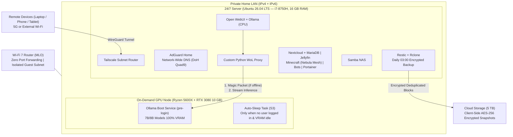

# Self-Hosted Homelab & Hybrid AI Architecture

> Turning a repurposed laptop into a 24/7 Ubuntu server with network-wide DNS filtering, automated encrypted 3-2-1 backups, zero-exposed-port remote access, and on-demand RTX 3080 GPU offloading via Wake-on-LAN.

---

## Why I Built This

Instead of paying for multiple SaaS subscriptions or leaving a power-hungry desktop running 24/7, I designed a **two-tier hybrid homelab**:

1. **Always-On Low-Power Core (`homeserver`):** A repurposed ASUS laptop running Ubuntu 26.04 LTS 24/7 for DNS filtering, private cloud, media streaming, NAS storage, lightweight LLMs, and VPN routing.
2. **On-Demand GPU Worker (`workstation`):** A Windows 11 desktop with an **RTX 3080 (10 GB VRAM)** that stays asleep or powered off until I actually send a prompt to a larger LLM — waking up automatically via **Wake-on-LAN** and returning to **S3 Sleep** when idle.

---

## System Architecture

---

## Hardware & 24/7 Laptop Hygiene

| Node | Hardware | Role |
| :--- | :--- | :--- |
| **Server (24/7)** | Intel i7-8750H (6C/12T), 16 GB RAM, 256 GB SSD (OS) + 1 TB HDD (Data) | Core services, Docker host, NAS, DNS, VPN Subnet Router |
| **GPU Workstation** | AMD Ryzen 5 5600X, 32 GB RAM, NVIDIA RTX 3080 (10 GB VRAM) | Development workstation + on-demand LLM inference |
| **Mobile & Remote** | Ryzen 7 5800H Laptop, Flagship Phone (Wi-Fi 7 MLO), Tablet | Remote access via Tailscale & native SMB |

* **Battery Protection:** A custom `systemd` unit pins `/sys/class/power_supply/BAT0/charge_control_end_threshold` to **60%** on every boot to prevent battery swelling during 24/7 AC operation.
* **Disk & Thermal Monitoring:** `smartmontools` (`smartd`) monitors SMART health continuously; CPU idles around **47 °C** with ~4.5 GB / 14 GB RAM used across 9 containers.

---

## Services Stack

| Category | Stack | Purpose |
| :--- | :--- | :--- |
| **Network & DNS** | AdGuard Home | Network-wide ad/tracker blocking (IPv4 + IPv6 Link-Local DNS) with Quad9 DNS-over-HTTPS |
| **Remote Access** | Tailscale + Nebula | Private WireGuard Subnet Router (personal devices) & isolated Nebula mesh for friends' Minecraft access |
| **Local AI** | Open WebUI + Ollama | Unified chat UI backed by both 24/7 CPU models and on-demand RTX 3080 models |
| **Private Cloud & Media** | Nextcloud + MariaDB, Jellyfin | Self-hosted file sync and media server |
| **Storage** | Samba (SMB) | Structured LAN/Tailscale NAS accessible natively on Windows & Samsung My Files |
| **Management & Bots** | Portainer + Docker Compose | Stack orchestration plus 2 custom automation bots |

---

## Highlight 1: Hands-Free RTX 3080 Offload (WoL Proxy + Auto-Sleep)

1. **Zero-Dependency Python Streaming Proxy ([`scripts/ollama-wol-proxy.py`](scripts/ollama-wol-proxy.py)):**
   * Caches `/api/tags` and `/api/version` locally so GPU models remain visible in Open WebUI while the desktop is off — background polling never triggers accidental wakeups.
   * On inference requests (`/api/chat`, `/api/generate`, `/v1/*`), if the workstation is offline, it sends a **Wake-on-LAN Magic Packet**, waits until Ollama responds, and streams tokens back in real time.
2. **Pre-Login Windows Boot Service:**
   * A Windows Scheduled Task (`SYSTEM`) launches `ollama serve` at boot with `OLLAMA_FLASH_ATTENTION=1` and `OLLAMA_KEEP_ALIVE=10m`, working even at the lock screen.
3. **Smart Auto-Sleep ([`scripts/check-idle-autosleep.ps1`](scripts/check-idle-autosleep.ps1)):**
   * Runs every 5 minutes and suspends to **S3 Sleep (~2–4 W, ~3 s next wake)** only when:
     1. No interactive user session (`explorer.exe` absent — never interrupts gaming/coding or `Win+L`);
     2. Zero models loaded in VRAM (`/api/ps` empty) and no active TCP connections on Ollama's port;
     3. Two consecutive idle checks (~10 min after VRAM unload).

---

## Highlight 2: Automated Encrypted 3-2-1 Backups

Implemented in [`scripts/homelab-backup.sh`](scripts/homelab-backup.sh) and triggered daily at `03:00` via `systemd` timer (`Nice=10`, `IOSchedulingClass=idle`):

1. Takes a consistent compressed SQL dump of MariaDB (`--single-transaction --quick`) before backing up.
2. Uses **Restic + Rclone** (dedicated OAuth Client ID, `--pack-size 64`, `--tpslimit 2`) to upload deduplicated, **client-side AES-256 encrypted** snapshots.
3. Covers application data, Docker named volumes, Samba shares, and critical `/etc` configs with automated retention (`14 daily / 4 weekly / 6 monthly`) and integrity checks (`restic check`).

---

## Security & Network Hardening

* **Zero Exposed WAN Ports:** No IPv4/IPv6 port forwarding, DMZ, UPnP, WPS, or WAN ICMP ping enabled on the router.
* **Network Segmentation:** Dedicated Wi-Fi 7 MLO SSID (WPA3) and isolated Guest Wi-Fi on a separate subnet with Ethernet bridging disabled.
* **SSH & Host Firewall:** OpenSSH hardened to **Ed25519 keys only** (`PasswordAuthentication no`, `PermitRootLogin no`). `ufw` restricts SSH and Portainer strictly to trusted static IPs and the Tailscale CIDR, and binds local AI proxy ports strictly to `docker0`.
* **Endpoint Firewalls:** LAN-only workstation SMB shares restricted to Private network profiles with dedicated hidden local credentials, automatically blocked on public Wi-Fi.

---

## Disclaimer

All scripts in this repository are **sanitized templates** using placeholder IPs, MAC addresses, and paths. No real credentials, tokens, certificates, or private network identifiers are stored here.
